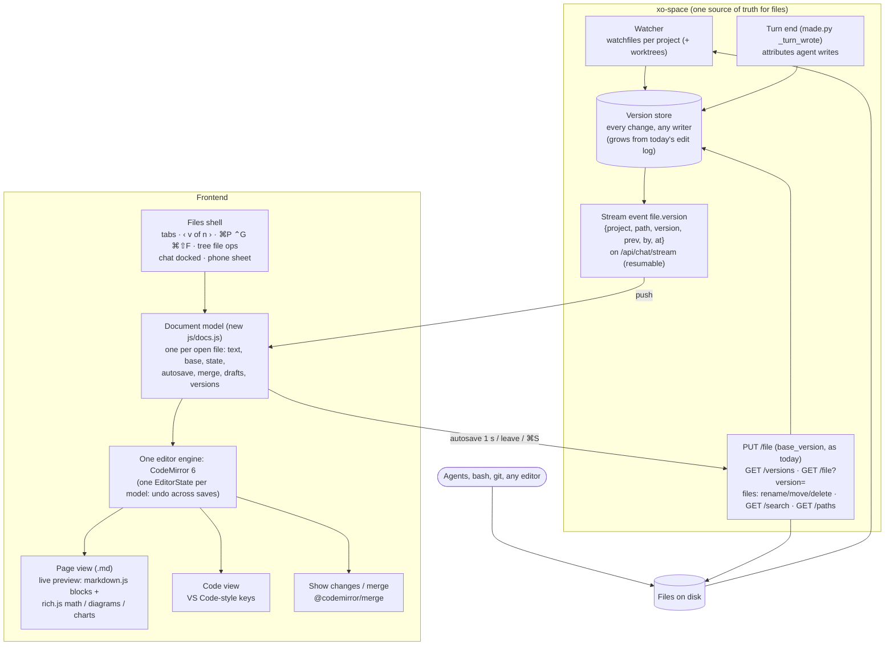

# Files: the root-fix plan

19 Nov 2026. This is a plan; nothing has been built.

The owner, 09:43Z: "research further properly and then tell me the plan, how everything works today, how it would be changed. I want it to be done as root fix, not just some patch that make it look more sluggish."

It builds on four other notes in this folder:
- `README.md`: the system map (A) and versions (V);
- `files-as-editor.md`: the editor engine;
- `vscode-behaviours.md`: what to copy from VS Code;
- what was read from this machine on the way: code-server's defaults, Space's `openapi.json`, `/opt/xo-space`, inotify limits.

---

## 1. How it works today, and why it feels clunky

### What happens

- **Opening.** Every way in ends at `VW.open` (`js/viewer.js:914`), a single viewer in the Files view, with the chat docked on the right.
- **Reading.** A Markdown file is drawn by our chat renderer (`markdown.js`). Code is drawn by Pierre, a diff viewer that also draws whole files (`diffview.js:300`).
- **Editing.** Edit re-reads the file (`purpose=edit`), destroys the drawing, and attaches Pierre's small editor to a raw-text view (`viewer.js:329`). The head becomes Cancel · Save.
- **Saving.** `PUT /file` with the version you started from. Space hashes the bytes, writes atomically and logs the save (UI saves only). A 409 comes back with the current content, and the browser merges (`merge3`).
- **Agent changes.** The browser *guesses* them. An agent's edit-tool step finishes → `/changes` is re-read → if the hash moved, one more `GET /file` → **Updated · Show**. This is off while you edit (`viewer.js:896`).

### The five root causes

| # | Root cause | What you feel |
|---|---|---|
| **R1** | **No model of an open file.** One file's state is spread over four objects (`V`, `ED`, `FL`, `DF`) in a 1,186-line `viewer.js`. "Preview / Source / Edit / Diff / Merge" are *view modes*, not file states, so changing what you do means tearing down one view and drawing another. | The Edit → Cancel/Save mode, "Opening…", a re-read on Edit, scroll lost on switching, drafts as a side system. |
| **R2** | **Two engines: one to read, another to edit.** `markdown.js` draws the page; Pierre's diff viewer, with an editor bolted on (`vendor/pierre-diffs/edit.js`, patched), edits raw text. | You can't edit what you're looking at. The editor is basic: no multi-cursor, no line moves, no Markdown widgets. |
| **R3** | **XO doesn't know when a file changes. It infers it.** Only from an agent's edit-tool rows, only in the current view's place, then by polling `/changes`. No file watching anywhere (Space has none). | Bash writes, VS Code, `git pull`, committed files and other threads' writes are never seen live. "Updated · Show" instead of the new version. |
| **R4** | **History covers only your saves.** Agents' versions aren't kept, and Space's Undo reverts one save at a time. | There's no "v3 of 5", no "what did the agent change", no restore of an agent's earlier text. |
| **R5** | **One file at a time, and Space has no file operations.** No tabs, quick open, project search, rename/move/delete. | Clicking around replaces what you had open; any file work goes through an agent. |

Patching on top of R1–R3 (more buttons, more polling, more modes) is what makes it feel slow. The fix is to replace the three layers underneath.

---

## 2. The target: three layers, as VS Code does it, made our own

VS Code keeps **one model per open file** with a few states (saved, dirty, saving, conflict, deleted, error). Every view of that file shares the model, and a file watcher feeds it. We copy that shape and add what VS Code lacks: who made each version, documents as pages, and phones.

### 2.1 Space

**S1. Version store.** This grows out of today's edit log (`services/project_files/edits.py`): same blobs, retention (30 days / 200 MB) and secret rules.
- **What it records:** every content change of a project file, whoever made it: `{id, path, worktree, version, prev, at, by: {kind: you|agent|disk, session, thread, turn, message_id}, size}`.
- **Merge window:** changes by the same writer within **10 s** fold into one version, as VS Code's local history does.
- **Where each record comes from:**
  - **Your saves:** `PUT /file`, as today.
  - **The watcher (S2):** records a change the moment it lands. If an agent's turn is running in that folder, the change is tentatively the agent's; otherwise "changed on disk".
  - **Turn end:** `made.py:186` already lists the files an agent's tools wrote. It confirms the attribution and links the reply message.

**S2. Watcher.**
- **What it watches:** `watchfiles` (already in Space's venv) on each project folder and its worktrees.
- **What it ignores:** `.git/` internals, `node_modules`, `.xo/` except worktrees, and files over 1 MB (recorded as "changed", without content).
- **Timing:** changes are debounced ~150 ms.
- **Limits are no worry:** 1,048,576 inotify watches on this machine. `xo-coworker` is ~150 folders, or ~8,500 with its 65 worktrees.
- **If the watcher overflows,** it rescans, and clients re-check their open files.

**S3. Push.** A **stored** stream event `file.version` on the stream the UI already reads (`/api/chat/stream`).
- Because it's stored, a browser that reconnects replays what it missed (`Last-Event-ID`). Nothing is lost while a laptop sleeps.
- It replaces the browser's guessing (R3).

**S4. Routes.**
- `GET /versions?relative_path=`, and `GET /file?version=`.
- `POST …/files/rename | move | delete`. These are logged, undoable, and follow the read-only and runs-code rules.
- `GET /search?q=&regex=&case=` (`git grep`; ripgrep isn't installed).
- `GET /paths` for ⌘P (`git ls-files` plus untracked files).
- **`PUT /file` stays as it is:** the version check and atomic write are already right.

### 2.2 Frontend

**F1. Document model** (new `js/docs.js`, about 400 lines, no DOM). One model per open file: `{project, rel, text, base, version, state, versions, confirmRunsCode}`.

| State | What it means | What happens next |
|---|---|---|
| `saved` | What's on screen is what's on disk | An incoming `file.version` is applied in place as an editor change: your caret and scroll stay, and the changed lines are tinted. It shows as the new version. |
| `dirty` | You typed and it isn't saved yet | Autosave 1 s after the last key, when you leave the file, or ⌘S. An incoming version is **merged into your text** (`merge3`, as today). Your text is never replaced. |
| `saving` | A `PUT` is out | Typing goes on; what you typed since stays dirty against the new version (as today). |
| `conflict` | You and someone else changed the same lines | The merge view, with "N places to choose". Nothing else is blocked. |
| `deleted` | Gone on disk | The tab and your text stay. "Save again" recreates the file. |
| `readonly` | Space's read-only places, over 1 MB, an attachment | No caret; it says why. |
| `error` | A save failed | Your text stays; it says why in words; retry. |

The model also:
- keeps **drafts** (`drafts.js`, unchanged), which is "hot exit";
- **asks once for files that run code** (Space's 428);
- **ignores its own echo**: an event whose version it just saved;
- is **pure**, so it's tested in node with a fake clock (autosave timing, 409, incoming while clean or dirty, deleted, read only).

**F2. One editor engine: CodeMirror 6.** Vendored like Pierre is, loaded when Files first opens. One `EditorState` per model, so **undo keeps working past autosaves**.
- **Code view:** our theme and tokens, multi-cursor, ⌘D, ⌥↑↓, ⌘/, folding, a regex find panel, and a slim Ln/Col foot.
- **Page view (`.md`):** the same editor with live-preview decorations. Headings, lists and tables are drawn as text; the Markdown marks show only on the caret's line. Math, diagrams and charts are widgets drawn with **`rich.js`'s caches** (the chat-view thread's work), so a formula looks the same in chat and in the file.
  - **"Source"** is the same editor with the decorations off: an instant toggle, the same caret and undo.
  - **No Edit button anywhere.**
- **Show changes and merge:** `@codemirror/merge` replaces Pierre's merge view in the viewer. **Pierre stays for the Changes pane's read-only diffs** (they work well).
- **Images, PDF, HTML:** as today.

**Why it won't feel sluggish:**
- The engine draws only the visible lines, and decorations are worked out for the viewport only.
- Each key costs work proportional to the change, never a read of the whole text.
- Saving is a background `fetch`.
- Updates are pushed, not polled.
- Math and diagrams draw after an input pause, in small slices (`rich.js`, the 19 Nov "page is never idle" rule).
- There's no re-read and no redraw when you start editing, because there's no "start editing".

**F3. Files shell** (`filesview.js`, `files.js`):
- **Tabs:** a single click opens a preview tab (italic, replaced by the next single click); typing or a double-click keeps it. A dot means saving or unsaved. ⌘⇧T reopens.
- **The head:** `‹ v of n ›` · who made this version (linked to their message) · **Show changes** · on an older version, **Restore** and **Back to latest**.
- **Getting around:** ⌘P, ⌃G, ⌘⇧F; clickable breadcrumbs.
- **The tree:** new, F2 rename, delete, drag to move.
- **The chat** stays docked as today (Layout A).
- **On a phone,** tabs fold into a menu and the chat is a sheet, as today.

**F4. The viewer's outside stays the same.** The rest of the app reaches the viewer through 8 calls (`open`, `close`, `isOpen`, `file`, `notice`, `leave`, `hasFile`, `editing`). They stay, so `app.js`, the Map, Artifacts and the chat chips don't change shape. Only what's behind them is replaced.

### 2.3 What gets deleted

- The Edit / Cancel / Save head and the `E` key.
- `startEdit`, `stopEdit`, `cancelEdit`, the `purpose=edit` re-read on Edit, and the `V`/`ED`/`FL`/`DF` split (`viewer.js`).
- The Pierre **editor** (`vendor/pierre-diffs/edit.js`) and its find-bar patch.
- The "Updated · Show" button, and `notice()`'s polling of `/changes` for the open file.
- The "Saved · Undo · Tell the agent" toast. Undo becomes versions. Tell the agent is automatic: Space's `person_edits` already notes your edits at the agent's next turn.

---

## 3. How it flows

**You type.**
1. A CodeMirror transaction updates the model, which turns `dirty`. The draft is kept after 800 ms.
2. One second after your last key, `PUT /file` goes out with `base_version`.
3. Space writes the file and records a version (`by: you`, folded into the last one within 10 s).
4. A `file.version` event goes out. Your own tab ignores the echo; your other tabs and devices take it.

**An agent writes** (its tool, or bash; or `git pull`; or another editor):
1. The file changes on disk. The watcher records a version (`by: agent <thread>` if a turn is running there, else `disk`), and the `file.version` event goes out.
2. Your open model:
   - if it's `saved`, the change is applied in place and tinted, and the head says **v6 · by "Pricing" thread**;
   - if it's `dirty`, the change is merged into your text, and only real clashes ask.
3. At the end of the turn, Space links that version to the agent's reply. The doc chip in that reply opens **v6**.

**You open an old version.** `GET /versions` fills the stepper, and `GET /file?version=` loads one. It's read only, with Restore (a normal save, so it's a new version too).

## 4. When things go wrong

| Case | Handling |
|---|---|
| Two writers at once | Space's version check (as today) plus the browser merge. Same-line clashes go to the merge view. |
| Browser offline or asleep | Stored events replay on reconnect. Missing versions come from `GET /versions?since=`. Drafts hold unsaved text. |
| Reload or closed tab mid-edit | Drafts (as today). Autosave leaves at most ~1 s unsaved. |
| Large files | Up to 1 MB editable (the engine draws only what's on screen). Over 1 MB read only, as today. Versions keep a hash only, no content. |
| Files that run code (`.claude/**`, `.git/**`) | Ask once at the first autosave, then go on (Space's 428). |
| Read-only places, attachments | `readonly` state, saying why. |
| Deleted or renamed outside | `deleted` state, with your text kept. Later: detect a rename by hash and follow it. |
| Watcher overflow | Space rescans; the browser re-checks its open files' versions. |
| Secrets (`.env*`, `*.pem`, …) | Versions are kept in memory only, as today's rule. |

## 5. Phases (each one ships whole, no stopgaps)

| Phase | What | Where | Size |
|---|---|---|---|
| **P1** | Version store (S1), watcher (S2), `file.version` event (S3), `GET /versions` and `/file?version=` | xo-space | 1.5–2 days |
| **P2** | Document model (F1). CodeMirror 6 with the code view (F2). Autosave. Version head with Show changes and Restore. The Edit mode, Pierre's editor and "Updated" deleted. | frontend | 2–3 days |
| **P3** | Page view for `.md` (live preview, `rich.js` widgets) and the instant Source toggle | frontend | 3–4 days |
| **P4** | Tabs (preview rule), ⌘P, ⌃G, breadcrumbs | frontend + `GET /paths` | 1–2 days |
| **P5** | Tree file work (new, rename, move, delete) and ⌘⇧F search | xo-space + frontend | 2 days |
| **P6** | Merge view on `@codemirror/merge`; tidy-up | frontend | 1 day |

About **two weeks** in all. P1 and P2 together give the first thing you'll notice: no Edit button, autosave, and agents' changes landing live as versions.

**Testing.** Node unit tests for the model and each new frontend module (with exit codes checked). pytest for the watcher, version store, attribution and routes. The ~10 existing unit tests built around Edit mode get rewritten: `editor-caret`, `editor-exit`, `edits`, `drafts`, `viewer-hooks`, `head-focus`, `head-redraw`, `focus-back`, `find-bar`, `find-race`. No browser suites unless the owner asks before a push (19 Nov rule). One small screenshot set per phase.

## 6. Things to settle before starting

1. **Today's release.** This is a ~2-week root fix, so none of it can land today without being a patch. Recommendation: **today's release ships the other fixes** (Back to Chat, Stop button, dismissable stopped notice, chat view). P1 and P2 start now. The first visible piece is ~3 days out.
2. **xo-space's branch.** The file routes this builds on (`/file` save, `/edits`, `/changes`) **are not on xo-space `main`**. The running Space (`/opt/xo-space`) is the same code as branch `xo/thread-db1062`. P1 has to be built on that line, and the coordinator should confirm which branch is the real one before any Space work.
3. **Coordination.**
   - The page view needs `rich.js` to export its draw/cache calls (the chat-view thread).
   - The Back to Chat fix touches `filesview.js`, so P4 goes after it.
4. **A new vendored library:** CodeMirror 6 (~75 kB gzipped core, plus languages on demand), alongside Pierre, which stays for read-only diffs.
