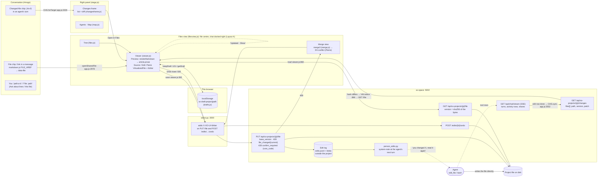

# Editing a document in place: the system map, and three options for XO

Research only, 19 Nov 2026. No product code was changed.

**What the owner asked for (08:57Z).** They want the Markdown viewer to feel like Claude's canvas: the document sits beside the chat, you edit it in place like a Word page, and it has headings, text, equations and graphs.

**What they said back (09:02Z), on Option 1:** "don't build anything yet. first research properly how everything maps out and connects."

So this note is in four parts:

- **A** maps today's system end to end.
- **B** sets each option against that map.
- **C** asks where a document should open, now that the full-width chat view is becoming the default.
- **D** is the reference research (how other tools do it).

**The owner, 09:12Z:** "it should update and show as a new version. That's what I asked you to research for … Research how Claude/ChatGPT/Gemini UIs offer these things. I want that." That is answered first, in **V**. Parts A–D below are the system map it rests on.

---

## V. Every change is a new version: how Claude, ChatGPT and Gemini do it, and how XO gets it

### V1. What the three do

| | Claude (artifacts; Claude Science files) | ChatGPT Canvas | Gemini Canvas |
|---|---|---|---|
| **When the AI changes the doc** | It **updates in place to the new version**: "each edit creates a new version". In Claude Science: "When Claude saves the same filename again … the artifact gains a new version." | The canvas rewrites in place; the new text *is* the current version. | The doc updates in place; Gemini "will apply updates". |
| **Moving between versions** | A **version stepper** (a version dropdown on claude.ai; arrows at the foot in older builds). | **Version arrows** in the top toolbar. | **Previous version / Next version** at the top of the Canvas panel ("To view your saved versions, at the top, click…"). |
| **Seeing what changed** | A **diff toggle**: "you can choose which earlier version to compare against; the previous version is the default." | **Show changes** in the toolbar: "additions and deletions" between versions, for documents and code. | Not documented. **Suggest edits** proposes changes instead of applying them. |
| **Going back** | Older versions are **read only**; to restore one, ask Claude to save it again. | **Restore** an earlier version (the back button). | Step back to a saved version. |
| **Your own edits** | Type in the doc, or (Claude Science) **Edit content → Save**, which "creates a new version". Editing a table cell saves a new version. | Type in the canvas. Edits are kept with the version. | Type in the canvas; "Changes are auto-saved." |
| **Aiming the AI** | Select text → **Edit with Claude**. | Select text → **Ask ChatGPT** (a targeted edit). | Select text → **Ask Gemini** box beside it. |
| **Chat ↔ version** | Claude Science: "Links Claude puts in the conversation point to the specific version that existed at the time." | Each assistant turn that edited the canvas marks a version. | Same. |

What they agree on:

1. **The AI's change lands as the new current version.** You don't get a "something changed, click to see it" button.
2. **A stepper** (‹ 3 of 5 ›) is always in the doc's head.
3. **"Show changes" compares against the previous version** by default.
4. **Old versions are read only**, and Restore makes them current again (a new version, so nothing is lost).
5. **Each version belongs to a turn in the chat**, and the chat's link to the doc opens the version that turn made.

### V2. What this looks like in XO

```
┌─ Files ──────────────────────────────────────────────────────┬─ chat (docked) ─┐
│ ‹  v5 of 5  ›  · edited by "Pricing page" thread · 2 min ago │                 │
│               [Show changes]                    ⋯   —   ×   │  Agent: I've    │
│ ─────────────────────────────────────────────────────────────│  updated the    │
│  # Pricing                                                   │  tiers and the  │
│  ░ Three tiers, billed monthly.            ← changed (tint)  │  chart. [doc ▸] │
│  $$ p = c \cdot (1+m) $$                    (drawn)          │                 │
│  [ chart ]                                                   │                 │
└──────────────────────────────────────────────────────────────┴─────────────────┘
 Older version:  ‹ v3 of 5 › · by you · 10:42   [Restore this version] [Back to latest]
```

- **An agent edits the open doc.** When its turn ends, the page moves to **v(n+1)** on its own, with no "Updated · Show" button. The blocks that changed carry a soft tint for a few seconds. The head names who made the version and links to their message.
- **You edit** (click a block and type, as in Option 1). Your autosaves fold into **one version per editing stretch**: it closes when you leave the doc or after ~2 minutes without typing. "by you" then shows as one step, not fifty.
- **Agent and you at once.** If you're typing when the agent's version lands, your text stays where it is. Their change is merged in (`merge3`, as at a save). Only a place you both changed asks you to choose.
- **‹ ›** steps back through older versions. These are read only, with **Restore this version** (saved as a new version, so it's undoable) and **Back to latest**.
- **Show changes** draws the doc with additions highlighted and removals struck through against the previous version. Pierre's side-by-side diff stays one click away for code.
- **The chat.** The doc chip in the reply that made v5 opens v5. If there's a newer version, it says so ("v5 · latest is v7").

### V3. What XO has and what's missing (from the map in A)

| Needed | Today | Gap |
|---|---|---|
| Your saves as versions | **Yes.** Space's edit log (`services/project_files/edits.py`) records each UI save, with both blobs, `from_version` / `to_version` and an `edit_id`. `GET /api/xo-projects/{p}/edits?relative_path=` lists them. | Group autosaves into stretches (UI side, or a `stretch` id on the record). |
| **Agent changes as versions** | **No.** Agents write straight to disk. Space's `Made` hears each turn's end and **already lists the files that turn wrote**, with the turn's reply message (`_turn_wrote`, `services/cowork_agent/storm/made.py:186`). It keeps no content. | **Space:** in `_turn_wrote`, for each written file, hash it. If it differs from the last logged version, `edits.record(target, None, bytes, kind="agent")` with the thread, turn and `message_id`. That's ~30 lines plus 4 fields on `Edit`, reusing the same blobs, retention (30 days / 200 MB) and secret rules. |
| The first version | Partly: `GET /file-history` (git log) and `GET /file?commit=`. | v1 = the file at HEAD (or the first logged version) when the log has nothing older. |
| A list of versions | Partly (`GET /edits`, UI saves only). | **Space:** `GET /api/xo-projects/{p}/versions?relative_path=` → `[{n, version, at, by: {kind: you\|agent, thread, title}, message_id, size}]`, plus each version's content from its blob (`GET /file?version=sha256:…`). |
| Telling the viewer at once | **No push.** The viewer polls `/changes` after an agent's edit step, which misses bash writes, committed files and other places (A7). | **Space:** the `made {items}` SSE event already goes out when a turn's writes are recorded. Add `version` to each item. **Frontend:** the viewer listens and moves to the new version. A7's gaps close for every turn-tool write; bash writes still need the turn-end hash check described above. |
| Restore | **Yes.** It's just a `PUT /file` with the old content (logged, undoable). | Nothing new on the server. |
| Show changes | `merge.js changes()` (line diff), Pierre diff view. | **Frontend:** a block-level diff on the rendered page (added = tint, removed = struck), from line ranges (`data-l`). |
| Version ↔ chat message | `Made` rows carry `message_id`. | **Frontend:** the chip in that message opens `?version=` that version. |

### V4. What can ship today, and what follows

- **Today, frontend only (≈½ day):** when the open doc changes (today's detection, A7), **move to the new version automatically** instead of showing "Updated · Show". Tint the changed blocks, and show a **‹ v of n ›** stepper with **Show changes** for the versions *this browser has seen* since the doc opened, plus **Restore** (a `PUT` of the older text).
  - **Limits:** history starts when you open the doc. Bash writes are still seen late. No xo-space change.
- **Next (≈1 day, Space + frontend):** agent versions recorded at turn end, `GET /versions`, `version` on the `made` event, and the chip-to-version link. The stepper then shows the whole history from any device, and updates arrive the moment the turn ends.
- **With it:** Option 1's click-a-block editing and autosave, so "you" versions sit beside "agent" versions.

Line numbers are for `aea856f` (frontend). xo-space line numbers are for the build running on :5002, which is `/opt/xo-space`, the same code as branch `xo/thread-db1062`. Its `main` doesn't have the file routes yet. The xo-space routes were confirmed against `GET /openapi.json`, and `/file` and `/changes` with live GETs.

---

## A. Today's system, end to end

### A1. The picture



### A2. Opening a file

Every way in ends at `VW.open(f, from)` (`js/viewer.js:914`). The viewer is mounted in the **Files** place (`js/filesview.js`). On a desktop with a conversation, that's **Layout A**: the file in the middle, the same chat docked in a 400 px column on the right (360–560 px, dragged), and the right panel steps aside. The owner picked this on 5 Nov; see `design-research/2026-11-vision/fileview-ux`.

| Way in | Code | What it opens |
|---|---|---|
| A path or link in a message | `markdown.js` `FILE_HREF` → `data-file` → `openSharedFile` (`app.js:2978`) → `fileRoute` (`app.js:2970`): project-relative in a project chat, otherwise `sharedFileRoute` (`timeline.js`) for a thread's own folder | The file, whole (Preview for `.md`) |
| A shared file or picture in a message | `openMedia` (`app.js:2956`) → `viewerFile` (`media.js:273`) | A project file `{project, rel}`, or an attachment `{att}` (read only: attachments sit in `.xo/attachments/`, a read-only place) |
| An agent's changed-file chip | `.tb-cf` (`app.js:3320`) → the panel's Changes diff; when docked or with ⌘-click, `VW.open({…, show:"changes"})` | The diff, then File |
| The Files tree, the panel's Changes, Artifacts, the Map | `FILES` (`files.js`), `changesframe.js`, `MAP.openFile` (`app.js:269`), lightbox "Open in Files" (`app.js:206`) | The file |
| "Ask about lines" capsule in your own message | `openLineRef` (`app.js`, `lineRef` in `changes.js:37`) | The file with those lines selected |

### A3. Reading and rendering

- **Reading.** `load()` (`viewer.js:860`) calls `api.projectFile(project, rel)` (`api.js:331`), which is **`GET /api/xo-projects/{p}/file?relative_path=…`**. On the server that's `project_file` (`routers/cowork_agent/bff/xo_projects.py:416`) → `read_text` (`services/project_files/read.py:127`).
- **What comes back** (checked live): `name, kind (markdown|html|text), size_bytes, modified_at, truncated, content, version, editable, not_editable_reason, place (ordinary|runs_code|read_only), bom, line_endings`.
  - `version` is `"sha256:" + sha256(bytes)`. It's a content hash, not a time (`address.py:52,100`).
  - A preview stops at **256 KB** (`read.py:36`) and has `version: null`.
- **Rendering.** A Markdown file in Preview becomes `<article class="prose vw-md">${renderMarkdown(text)}</article>` (`viewer.js:545`).
  - `renderMarkdown` (`markdown.js:303`) is our own line-based renderer, shared with the chat. Everything is escaped and the only tags are ones it builds.
  - Source mode and code files are drawn by **Pierre**: `drawFile` (`viewer.js:667`) → `DV.file` (`diffview.js:300`), a virtualised, Shiki-coloured line view with line selection.
- **Math, diagrams, charts (chat-view thread, `cmsg_bff772ae…`, not merged yet).**
  - That thread is adding them **inside `js/markdown.js`**: `$…$`, `$$…$$`, ```` ```math ````, ```` ```mermaid ````, ```` ```chart ````, plus `setRich(hooks)`.
  - A page-wide `js/rich.js` (`startRich()`) uses a MutationObserver on `document.body` to find and draw them. It loads KaTeX (270 kB) and Mermaid (lazily, by diagram type) after 600 ms with no input, and caches each drawing by its source.
  - `js/chart.js` draws the charts as SVG.
  - Because the viewer calls the same `renderMarkdown` into the same document, **a `.md` file in Preview gets equations, diagrams and charts with no viewer change** once that thread lands. (One check is still to do: Preview's `article` isn't in a shadow root. Pierre's views are.)

### A4. Editing (today's "mode")

- **Can you edit?** `canEdit()` (`viewer.js:267`) says yes only for a project file (not an attachment or a paste), text, with `editable` true and a version.
- **Getting into the editor.** Edit / `E` (`:1042`, `:1135`) → `startEdit()` (`:329`):
  1. A document switches to **Source** (`:342`).
  2. The whole file is read again with **`purpose=edit`**, which allows up to **1 MB** (`EDIT_MAX_BYTES`, `address.py:51`). Over that: 413 → "Too large to edit here".
  3. If you left a **draft**, the editor opens on the draft, against the version you started from (`:351`).
  4. **Pierre's Editor** is attached to the same VirtualizedFile (`diffview.js:324`, `vendor/pierre-diffs/edit.js`). It gives a caret, undo, find, and `onChange`.
- **The head.** It becomes `Edited · Cancel · Save ⌘S` (`editActs`, `:269`).
  - Cancel with changes asks "Discard your edits?" (`cancelEdit`, `:386`).
  - Esc leaves; with changes, they're kept as a draft (`:1182`).
- **What each key press does.** Only Pierre's own dirty check runs. The whole text is read for the draft 800 ms after a pause (`draftSoon`, `:132`).
- **Ask while editing.** "Ask about lines a–b" (`askCapsule`, `:714`) works in Source and in the editor. It sends `path:a-b\n\nquestion` to the file's thread, or else to its project coordinator (`app.js` `askAboutLines`).

### A5. Saving, versions, conflicts, undo

1. **Save** (`viewer.js:393`) → `api.saveProjectFile` (`api.js:337`), which is **`PUT /api/xo-projects/{p}/file`** with `{relative_path, content, base_version, confirm?}`.
   - `serve.py` adds the UI's writer key, `X-XO-UI-Writer` (`serve.py:104–130, 396`). Without it Space answers 403 `ui_only`.
   - On the server: `save_project_file` (`xo_project_files.py:79`) → `save()` (`services/project_files/save.py:243`).
2. **Space's checks, in order:**
   - **403 `read_only_place`:** `.xo/` outside a worktree, or a worktree's `.git` pointer.
   - **428 `confirm_required`, reason `runs_code`.** This covers any `.git` part, `.claude/**`, `.mcp.json`, `.codex/**` and `.agents/**` (from the agent manifests; `address.py:183–219`). AGENTS.md, CLAUDE.md and `.github/` are *ordinary*.
   - **409 `file_changed`** when the bytes on disk don't hash to `base_version`. It returns `current: {version, content, bom, line_endings}` (content only up to 1 MB), or `current: null` if the file was deleted.
   - Also: 413, 415, 507.
3. **How the write happens** (`save.py:128–210`):
   - Folders are opened with `O_NOFOLLOW`.
   - The new bytes go to a temp file `.<name>.xo-save.<hex>.tmp`, which is fsync'd.
   - The file's identity is checked again, then `os.replace` swaps it in.
   - BOM and line endings are kept.
   - **It never commits.** A save with no change writes nothing (`unchanged: true`).
4. **Locking.** A per-file lock covers XO's own saves only. Agents take no lock, so a small race between the check and the rename remains (documented at `save.py:18–20`). The server **never merges**.
5. **Every save is logged** (`services/project_files/edits.py`). The log is `edits.jsonl` plus compressed blobs, kept outside the project for 30 days or up to 200 MB. Each entry has an `edit_id`.
   - `GET /edits` lists the log.
   - **`POST /edits/{id}/undo`** puts the file back as it was before that one save. It answers 409 if the file has changed since, so **only the latest save can be undone safely**.
6. **What the viewer does with the answer:**
   - **200.** The toast says **Saved · Undo · Tell the agent** (`toastPaint`, `:500`). Undo calls `undoProjectEdit` (`api.js:340`). Tell the agent sends "I edited X. Read it again." `CHG.saved` re-reads `/changes` (`app.js:200`).
   - **428.** "Save anyway?" pops up (`:275`). The save is re-sent with `confirm: "runs_code"`, once per file per visit (`ED.confirmed`).
   - **409.** `clash()` (`:472`) runs `merge3(base, mine, current.content)` (`merge.js:61`).
     - If there are no clashes, it saves at once against the agent's version.
     - Otherwise **Pierre's merge view** (`DV.conflict`, `diffview.js:187`) shows "N places to choose", and Save stays blocked until each place is chosen.
   - **Typing while a save is out.** What was sent is saved; the rest stays as edits against the new version (`:420`).
7. **Agents hear about your edit.** `person_edits.py` adds a system note at the start of the agent's *next* turn naming the files you changed, up to 20 (`services/cowork_agent/storm/person_edits.py`). The integrity watch doesn't count your confirmed edits to `.claude/**` as the agent's.

### A6. Drafts

- **Where they live.** `js/drafts.js`: `localStorage` `xo-draft:<project>|<rel>` = `{text, base, version, at}`, plus an index. At most 20 drafts, none over 2 MB.
- **When they're written:**
  - 800 ms after a pause in typing;
  - on leaving the file (`:919`), on close (`:947`), when the tab is hidden (`:1105`), and before unload (`:1101`). If unload can't keep the draft, the browser asks.
- **Coming back.** You see "Your draft · Discard · Continue" (`:235`).
- **Limit.** A draft lives in *this browser only*. Another device won't see it.

### A7. How an agent's write reaches the viewer

There is **no file watching and no file-changed push**. Space has no watchdog or inotify for this, and the SSE streams (`/api/chat/stream`, `/api/chat/sessions/{id}/stream`, `/api/chat/events`) carry turns, activity rows and `share` events only. The chain is:

1. **The trigger.** An agent's `edit_file` / `create_file` / `delete_file` row finishes in a turn, which arrives over SSE. `activityIn` (`changes.js:61`) counts it, but only for **threads whose folder is the current view's place**.
2. **The re-read.** `CHG.sync(view)` on every render (`app.js:2552`) re-reads **`GET /api/xo-projects/{p}/changes[?worktree]`** (`changes.js:99`, server `services/project_files/changes.py:152`). That returns every file that differs from the base (a thread's branch point, or the project's HEAD), each with its `version` hash and patch.
3. **The check.** `VW.notice()` (`viewer.js:896`, called at `app.js:2583`): if the open file's entry has a new hash, the viewer confirms it with one `GET /file`, then lights **Updated · Show**. You choose when to take it (Stable inspection: what you're reading never changes under you).

**Gaps, all of which matter for any "live" document:**

- A write by **bash** (`sed`, `>`, a script) isn't an `edit_file` row, so it triggers nothing until some other edit does.
- A file that's **committed** (no longer different from the base) isn't in `/changes`, so it never shows Updated.
- Writes by a thread in **another place** than the one you're viewing aren't counted.
- **While you're editing, `notice()` is off** (`ED.on`). The first you hear of an agent's change is the 409 on your save.

What always catches it is **the version check at save time**. It's exact: the server hashes the bytes on disk.

### A8. The right panel vs the Files view

- **The right panel** (`js/stage.js`) is a stack of frames: Launchpad, Changes (list and diff), Agents, Map. It's 320–720 px wide.
  - Files used to open there. The owner moved them out on 4 Nov ("the right panel was too narrow to read a file").
  - While Files is open and the reader would drop below 560 px, the panel folds to a 40 px rail.
- **Files** (`js/filesview.js`) is a place in the main area: tree, file, and the docked chat.
  - "Put away" (— or Esc) turns the file into a chip in the thread's header; × closes it.
  - On a phone the file fills the screen and the chat is a sheet.
  - The purple **Back to Chat** button belongs here, and another thread is reworking it today.

---

## B. The three options against that map

Legend: **FE** = xo-coworker; **SP** = xo-space.

### Option 1: edit on the page, saved as you go (a block at a time)

**What you see.**
- The `.md` file opens as a page (Preview with document typography). There's no Edit button for documents.
- Click a block (a paragraph, heading, list, table, code, math or diagram) and *that block* becomes its Markdown in a rounded box. Everything around it stays rendered.
- Leave the block and it renders again. Saving happens by itself; a quiet *Saved* replaces Cancel and Save.

**Pieces it touches.**

| Piece | Change |
|---|---|
| `js/markdown.js` `renderMarkdown` (`:303`) | **FE.** An option to stamp each top-level block with its source lines (`data-l="a-b"`). Off for chat. *The chat-view thread is editing this file now, so this goes after theirs lands.* |
| `js/viewer.js` Preview (`:545`), the head (`:223–256`), `editActs` (`:269`), `startEdit` / `save` / `clash` (`:329–500`), `toastPaint` (`:500`), `notice` (`:896`) | **FE.** A click on a block opens a block editor. A splice puts its lines back into the whole text, and the existing `save()` runs on a timer instead of a button. The head's Edit / Cancel / Save go for `.md`. The toast becomes a quiet *Saved* plus *Undo changes*. `notice()` stays on while you're on the page. |
| `js/drafts.js` | **FE.** Unchanged. The draft is still the whole text, and it now lives for about a second between autosaves. |
| `js/merge.js` | **FE.** Unchanged. `changes()` is also used to tint the blocks an agent changed. |
| `css/fileview.css` | **FE.** Page typography and the block editor's look (rounded, with our tokens). |
| `app.js` `edits.saved` (`:200`) | **FE.** Throttled: `CHG.saved` re-reads `/changes` once you stop editing, not on every autosave. |
| `rich.js` / `chart.js` (chat-view thread) | **FE.** Nothing to do. The MutationObserver draws the viewer's math and diagrams too. |
| xo-space | **SP: nothing required.** Possible later: an "undo since" route (below). |

**When you edit.** Click a block → a textarea holds lines `a–b` of `V.data.content` → you type → the full text is rebuilt by splicing → 800 ms later the draft is kept (unchanged) → 1 s after the last key, or when you leave the block, `PUT /file` goes out with `base_version` = the last version → 200 → `V.data.version` advances → only that block is re-rendered. The rich caches keep math and diagrams from flickering.

**When an agent edits.** The chain in A7 → `notice()`:
- If you're **not** in a block and no save is pending, `GET /file` and swap in place. The blocks whose lines changed get a soft tint for a few seconds. This is ChatGPT's "show changes", made quiet. It does break the 5 Nov rule that "what you're reading never changes under you", so it needs the owner's say. The fallback keeps **Updated · Show**.
- If you **are** in a block, today's path: the next autosave gets a 409 → `merge3` → a clean merge saves on its own. A real clash opens Pierre's merge view, which is a mode jump, but a rare one.

**Failure modes.**
- **Agent writes that aren't seen live** (bash, committed files, another place; A7). They're caught by the 409 at the next autosave, so nothing is lost. "Live" is best-effort until Space pushes file changes.
- **Line ranges shift under an open block** after a merge. Keep the block's own base. After a merge, find the block again by its text, or close it if its lines changed.
- **Undo.**
  - Inside a block: the textarea's own undo, which is lost when you leave the block.
  - Space's undo reverts *one* save and fails after later saves, and autosave makes many. So "Undo changes" should mean **"back to how it was when you opened it"**: a normal `PUT` of the start text, logged and itself undoable. No SP change. If the owner wants per-step history later, SP could offer `POST /edits/undo-since`, or the UI can walk `GET /edits`.
- **Edit-log volume.** Every pause is a logged save with a blob; that's within the 30-day / 200 MB cap. The agent's note names the file once per turn. Coalescing (save on leaving a block plus every ~5 s while typing) keeps the log readable.
- **Reload or closed tab mid-pause.** The draft (`:1101`, `:1105`) covers it. Optionally a `fetch(…, {keepalive:true})` PUT on `pagehide`; it goes through `serve.py`, so the writer key is added.
- **Large files.**
  - Over 256 KB, the preview is cut and has no version, so the page reads `purpose=edit` (up to 1 MB) before the first block opens.
  - Over 1 MB it's read only, as today.
  - Re-rendering per keystroke is avoided by redrawing only the edited block.
- **Files that run code.** `.claude/**` Markdown (agents, skills, commands) gets **428**. Never confirm automatically: ask once, at the first autosave, then go on, as `ED.confirmed` does today. Read-only places stay read only.
- **What can't be done in a block.** An edit across blocks, or moving a heading with its section, needs Source (which keeps the editor and autosaves the same way). Front matter, raw HTML and footnotes render as text today; they edit as one block.

**How the shared renderer plugs in.** For free: same function, same document, same observer. In a math or diagram block, the box shows its source with the drawing under it. Note that `rich.js` draws only after 600 ms with no input, so the preview updates after each pause, not on every key. That's fine, and it follows the 19 Nov "page is never idle" rule.

**Size.**
- About 1–1.5 days FE.
- **Today-sized part** (once the chat-view renderer lands): page typography; click a block to edit; autosave plus *Saved* and *Undo changes*; Edit / Cancel / Save gone for `.md`.
- **Later:** agent changes taken in with a tint; "Ask about this" on a selection in the rendered page (map the selection to `data-l` lines, then reuse the Ask capsule and composer).

### Option 2: one continuous live page (Obsidian Live Preview on CodeMirror 6)

**What you see.** One editable surface that looks rendered. The Markdown marks show only on the caret's line. Math, diagrams and charts are widgets that open to their source when the caret enters them. You can select across blocks.

**Pieces it touches.**

| Piece | Change |
|---|---|
| New `js/vendor/codemirror/` | **FE.** CM6 core, `@codemirror/lang-markdown` (Lezer), `@codemirror/view` decorations. About 250–400 kB minified (~75 kB gzipped for the core) plus the Markdown grammar, loaded only when a `.md` opens. |
| New `js/docedit.js` | **FE.** Decorations: hide the marks off the caret line, heading sizes, list bullets; replace-widgets for math, diagram, chart, image and table. |
| `js/rich.js` | **FE.** Needs an exported `draw(kind, src) → Promise<html>` (or reuse of its caches), because CM rebuilds widget DOM as you scroll. The observer would also work, but the cache API is cleaner. This is a request to the chat-view thread. |
| `js/viewer.js` | **FE.** `.md` uses `docedit` instead of Preview + Pierre. Pierre stays for code files, diffs, the merge view and Source. `save` / `clash` / drafts are reused unchanged. Autosave as in Option 1. |
| `js/markdown.js` | **FE.** Unused for the editable page, so the page and the chat **render with two engines** (Lezer vs ours). Small differences will show (lists, tables, link tokens) unless the widgets call `renderMarkdown` for blocks. |
| xo-space | **SP: nothing.** |

**When you edit.** CM transactions → whole text → draft → autosave `PUT`, as in Option 1, with CM's full-document undo history.

**When an agent edits.** Better than Option 1: the agent's new text is applied as a CM transaction, built from `merge.changes()`, so your caret and scroll stay put and the changed ranges can be tinted. `merge3` is still used when your unsaved text and theirs overlap.

**Failure modes.**
- Tables and nested lists: Obsidian took years to get these right.
- IME and mobile selection inside widgets.
- Two renderers drifting apart.
- 1 MB files are fine (CM virtualises the view).
- Runs-code, read-only and 409 handling are as in Option 1.

**Size.** 3–5 days FE to feel right; not today.

### Option 3: rich-text document (Word / Claude Docs: ProseMirror via Milkdown Crepe or Tiptap)

**What you see.** A word processor: toolbar, `/` menu, drag handles, an equation and chart insert, comments.

**Pieces it touches.**

| Piece | Change |
|---|---|
| New vendor ProseMirror stack | **FE.** Crepe pulls in Vue 3 and DOMPurify; Tiptap is lighter but needs our own UI. Plus a Markdown parser and serializer. |
| `js/rich.js` / `chart.js` | **FE.** Node views for math, mermaid and chart call the same caches. |
| `js/viewer.js` | **FE.** A new editing surface. `save` / `clash` are reused, but on **serialized** Markdown. |
| `js/merge.js` | **FE.** Line merges on serialized text clash with agents' formatting, so they'd need a tree-level merge. |
| xo-space | **SP.** Nothing for files. If XO wants its *own* document type (like Claude Docs: comments, presence, history as steps), that's a new store and API, which is weeks. |

**When you edit.** PM steps → serialize to Markdown → `PUT`.

**The catch.** The serializer rewrites what you didn't touch (list markers, wrapping, table padding, escapes). The first save of an agent-written file becomes a large diff. Agents and the editor then keep reformatting each other's work, `/changes` and the Changes pane show noise, and `merge3` reports false clashes.

**When an agent edits.** Parse its file → replace the document, which loses your caret unless mapped, or diff the trees.

**Size.** 1–2 weeks FE for files. Weeks more if it becomes XO's own document store.

### Side by side

| | Option 1 (block at a time) | Option 2 (live page, CM6) | Option 3 (rich text, PM) |
|---|---|---|---|
| Feels like | Notion and Typora blocks | Obsidian / Typora | Word / Claude Docs |
| File stays byte-exact for agents and git | Yes | Yes | **No** (reformatted on save) |
| New dependency | None | CodeMirror 6 | ProseMirror (+ Vue for Crepe) |
| xo-space changes | None | None | None for files; new store for XO docs |
| Uses `markdown.js` + `rich.js` as they are | Yes | Widgets only | Node views only |
| Agent edit while you're in it | 409 → merge3 at the next autosave | Transaction, caret kept | Re-parse or tree diff |
| Select across blocks | No (use Source) | Yes | Yes |
| Size | 1–1.5 d | 3–5 d | 1–2 wk |
| Today | Core, yes | No | No |

---

## C. Where a document opens, now that the chat view is the default

The candidates:

- **Files (Layout A), as today.** The document fills the middle and the same conversation is docked on the right (400 px, 360–560). This *is* the canvas arrangement: Claude and ChatGPT put the canvas beside a narrower chat. The only difference is the side (they put chat left, canvas right). The owner chose Layout A on 5 Nov, so the side stays as it is unless they say otherwise.
- **The right panel.** No. It's 320–720 px and holds Changes, Agents, Map and Launchpad. The owner took files out of it on 4 Nov because it was too narrow to read in. A page with equations and charts needs ~720 px.
- **Inside the chat stream** (the document drawn in a reply, edited there). No. The chat scroll is owned by `follow.js` and is fragile (see the memory note on anchoring). An editable page inside a growing, streaming list fights it.

**So:** a document opens in **Files, beside the docked chat**. The chat-view work and canvas editing meet in two places:

1. **The renderer.** The same `markdown.js` + `rich.js` draw a reply and a file, so an equation looks the same in both.
2. **The docked chat column.** Once the full-width chat view is the default, its rich replies (tables, charts, diagrams) also have to fit the 360–560 px column beside a file. Tables need to scroll sideways, charts to scale, and diagrams to fit width. That's a check for the chat-view thread.

**How you get to a document.** Today, a file path in a reply opens Files. When an agent writes a `.md` and shares it, the reply's file chip opens it as the page, ready to edit. Opening it automatically beside the chat when an agent creates a document would be the canvas move, but that's a separate decision for the owner.

---

## D. How other tools do it (reference research)

| Tool | View vs edit | Saving | AI edits next to yours | Math / charts / diagrams |
|---|---|---|---|---|
| **Claude: Docs / template artifacts** | No separate mode; you type in the doc | Live; export to Word, PDF, Markdown, Google Docs | Select → **Edit with Claude** → request; asks in chat update the doc live | Rich blocks, charts, diagrams |
| **ChatGPT Canvas** | Beside the chat; click in and type | Autosave; back and forward through versions | Select → **Ask ChatGPT** (a targeted edit); shortcuts; **Show changes**; inline suggestions to accept or ignore | Markdown-style; code canvases |
| **Notion** | Always editable; blocks, `/`, Markdown shortcuts | Continuous; page history | AI on a selection or block | `/equation` (KaTeX) with a live preview; Mermaid code block **Code / Preview / Split** |
| **Obsidian** | **Live Preview** (default; marks show at the caret) / Source / Reading, `⌘E` | Autosave to the `.md` | Plugins | MathJax, Mermaid; CM6 decorations over a plain file |
| **Typora** | One surface; a block shows its source while you're in it | Autosave (option) | None | MathJax 4, Mermaid 11, ```` ```math ```` |
| **Google Docs** | Always editable; *Suggesting* mode | Continuous; version history | Gemini side panel; suggestions | Equation editor; Sheets charts |
| **Linear docs / Craft** | Always-editable rich text, `/` menu | Live | Linear's AI writes into the doc | Craft math block; Linear code and Mermaid |
| **GitHub** (contrast) | **Write / Preview tabs**, which is XO's pattern today | Explicit commit | None | Math and Mermaid in Preview |

What they have in common:

- **No Edit button and no Save button.** Safety comes from history and undo, not from a confirm step.
- **Rich blocks show their source only while you're in them.**
- **AI edits are aimed by a selection,** and the changes are visible in the doc.
- **Plain-file tools** (Obsidian, Typora) keep the `.md` byte-exact. **Rich-store tools** (Notion, Docs, Craft, Claude Docs) own their own format.

---

## Recommendation

0. **Versions first (V):** an agent's change lands as the new version, with **‹ v of n ›**, **Show changes**, **Restore**, and chat links to the version a turn made.
   - **Today:** the frontend-only slice in V4.
   - **Next:** Space records agent versions at turn end and pushes them on the `made` event.
   - The owner's 09:12Z answer settles B's question about agent changes: they **update in place as a new version**. That replaces the 5 Nov "Updated · Show" rule for documents.
1. **Option 1**, built only after the chat-view thread's `markdown.js` / `rich.js` lands (they edit the same file).
   - **Today-sized core:** page typography; click a block to edit; autosave with *Saved* and *Undo changes* (back to how it was when opened); Edit / Cancel / Save gone for `.md`; runs-code files ask once.
   - **No xo-space change.**
2. **Keep documents in Files beside the docked chat** (Layout A). Not the right panel, not inside the chat.
3. **For the owner to decide:**
   - Should an agent's change be **taken in live with a tint** (which breaks the 5 Nov "never changes under you" rule), or stay as **Updated · Show**?
   - Should a document an agent creates **open beside the chat by itself**?
4. **Later:**
   - "Ask about this" on a selection in the page.
   - Option 2 (CM6 live page) if one continuous surface is still wanted after using Option 1.
   - A file-change push from Space (an SSE `file.changed` with path and version), to close the A7 gaps for bash and committed writes.
   - Option 3 only if XO grows its own document type.

## Sources

- Versions: [Claude Science, Artifacts › Versions](https://claude.com/docs/claude-science/artifacts) (version stepper, diff toggle against the previous version, chat links pinned to versions); [How to view version history of an artifact in Claude.ai](https://www.guideflow.com/tutorial/how-to-view-version-history-of-an-artifact-in-claudeai) (version dropdown); [OpenAI: Using canvas](https://help.openai.com/en/articles/9930697-using-canvas-in-chatgpt) (version arrows, Show changes, restore); [Gemini Apps Help: Canvas](https://support.google.com/gemini/answer/16047321?hl=en) (Previous / Next version, auto-save, select → prompt); [Gemini Enterprise: documents in Canvas](https://support.google.com/g/answer/16914858?hl=en) (version arrows on the editing bar, Ask Gemini beside a selection)
- Claude: [What are artifacts and how do I use them?](https://support.claude.com/en/articles/17153992-what-are-artifacts-and-how-do-i-use-them); [Artifacts](https://claude.com/features/artifacts)
- ChatGPT: [Using canvas in ChatGPT](https://help.openai.com/en/articles/9930697-using-canvas-in-chatgpt); [Introducing canvas](https://openai.com/index/introducing-canvas/)
- Obsidian: [Edit and read](https://help.obsidian.md/edit-and-read); [Editor decorations](https://docs.obsidian.md/Plugins/Editor/Decorations)
- Notion: [Advanced blocks (equation, Mermaid split)](https://thomasjfrank.com/learn-notion/advanced-blocks/)
- Typora: [What's new 1.9](https://support.typora.io/What's-New-1.9/); [Typora 1.13: MathJax 4, Mermaid 11.12](https://alternativeto.net/news/2026/3/typora-1-13-brings-mathjax-4-mermaid-11-12-improved-search-performance-and-ui-updates)
- BlockNote: [Source with preview blocks](https://www.blocknotejs.org/docs/features/custom-schemas/source-with-preview)
- CodeMirror: [Bundling, minimal setup](https://codemirror.net/examples/bundle/); [Ixora](https://npmjs.com/package/@retronav/ixora)
- Milkdown: [@milkdown/crepe](https://cdn.jsdelivr.net/npm/@milkdown/crepe@7.21.2/README.md)
- Google Docs, Linear and Craft are described from their public behaviour; I didn't re-check them against a page today.
